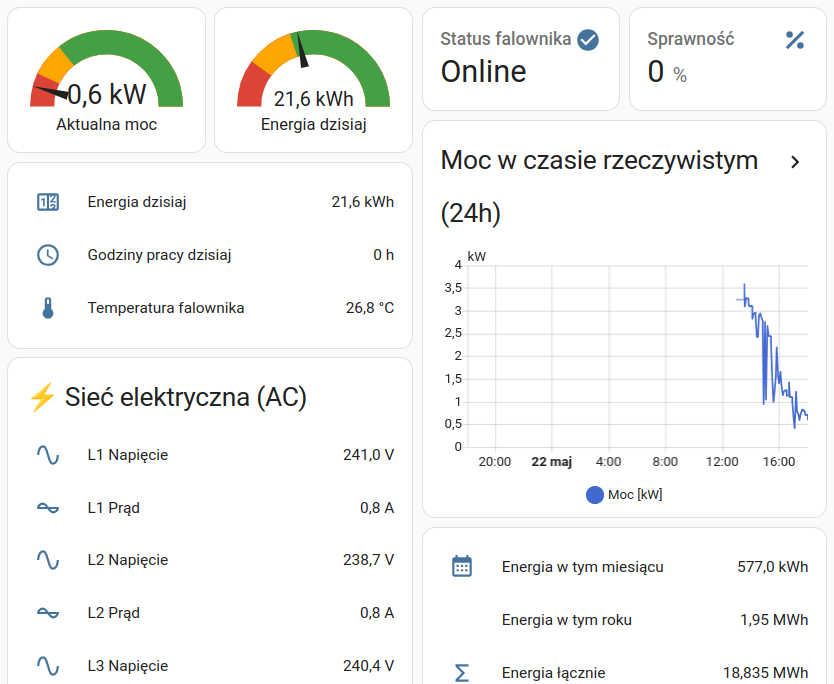

# 🌞 Solis Cloud Home Assistant Integration

Integracja Home Assistant dla instalacji fotowoltaicznych Solis Cloud.

## ⚡ Funkcje

- **22 sensory** z danymi produkcji energii i parametrami technicznymi
- **Automatyczna konfiguracja** przez interfejs graficzny
- **Wsparcie Energy Dashboard** - automatyczne wykrywanie sensorów energii
- **Aktualizacja co 2 minuty** z API SolisCloud
- **Polskie tłumaczenia** interfejsu

## 📊 Dostępne dane

### Produkcja energii
- Aktualna moc [kW]
- Energia dzisiaj [kWh]
- Energia miesiąc [kWh]
- Energia rok [MWh] 
- Energia łącznie [MWh]

### Parametry techniczne
- Temperatura falownika [°C]
- Godziny pracy dzisiaj [h]
- PV1/PV2: Napięcie [V], Prąd [A], Moc [W]
- AC L1/L2/L3: Napięcie [V], Prąd [A]
- Częstotliwość sieci [Hz]
- Sprawność falownika [%]
- Status połączenia

## 🚀 Instalacja

### Wymagania
- Home Assistant 2023.1+
- HACS zainstalowane
- Konto SolisCloud z aktywnym API

### Krok 1: Uzyskaj klucze API
1. Zaloguj się na https://www.soliscloud.com
2. Idź do **Service** → **API Management**
3. Aktywuj API i zaakceptuj warunki
4. Skopiuj **Key ID** i **Key Secret**

### Krok 2: Zainstaluj integrację
1. W Home Assistant otwórz **HACS**
2. Idź do **Integrations**
3. Kliknij **⋮** → **Custom repositories**
4. Dodaj URL tego repozytorium
5. Kategoria: **Integration**
6. Kliknij **Add**
7. Wyszukaj "Solis Cloud" i zainstaluj
8. Restartuj Home Assistant

### Krok 3: Skonfiguruj
1. Idź do **Settings** → **Devices & Services**
2. Kliknij **+ Add Integration**
3. Wyszukaj "Solis Cloud"
4. Wprowadź swoje klucze API
5. Station ID zostanie wykryte automatycznie

## 📱 Energy Dashboard & Example Dashboard

Po konfiguracji sensory automatycznie pojawią się w Energy Dashboard:
1. Idź do **Settings** → **Energy**
2. W sekcji **Solar panels** kliknij **Add**
3. Wybierz sensor `Solis Energia dzisiaj`

### Przykładowy dashboard z wszystkimi sensorami:


*Przykładowy dashboard pokazujący wszystkie dostępne sensory Solis Cloud*

Dashboard zawiera:
- **Gauges** - aktualna moc i dzienna produkcja energii
- **Wykres 24h** - moc w czasie rzeczywistym z historią
- **Parametry techniczne** - temperatura falownika, godziny pracy, sprawność
- **Sieć AC** - napięcia i prądy na fazach L1/L2/L3  
- **Statystyki długoterminowe** - energia miesiąc/rok/łącznie

## 🤖 Przykładowe automatyzacje

```yaml
# Powiadomienie o rozpoczęciu produkcji
automation:
  - alias: "Panele zaczęły produkować energię"
    trigger:
      platform: numeric_state
      entity_id: sensor.solis_aktualna_moc
      above: 0.5
    action:
      service: notify.mobile_app
      data:
        message: "☀️ Panele słoneczne rozpoczęły produkcję!"

# Alert przy wysokiej temperaturze falownika
automation:
  - alias: "Wysoka temperatura falownika"
    trigger:
      platform: numeric_state
      entity_id: sensor.solis_temperatura_falownika
      above: 70
    action:
      service: notify.mobile_app
      data:
        message: "🌡️ Temperatura falownika: {{ states('sensor.solis_temperatura_falownika') }}°C"
```

## 🔧 Troubleshooting

### Sensory nie pojawiają się
- Sprawdź logi: Settings → System → Logs
- Sprawdź czy API jest aktywne na soliscloud.com
- Sprawdź klucze API

### Błędy połączenia
- Sprawdź połączenie internetowe
- API ma limity - integracja czeka 2 minuty między zapytaniami
- Sprawdź czy na koncie SolisCloud są stacje/falowniki

## 📋 Licencja

MIT License - używaj swobodnie dla projektów osobistych i komercyjnych.

## 🤝 Wsparcie

Problemy i sugestie zgłaszaj w sekcji [Issues](https://github.com/coyotxxx/solis-cloud-ha/issues) tego repozytorium.
